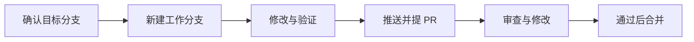

# GitHub Flow 与 Git Flow

Git 是记录代码历史的工具，GitHub 是托管仓库与审查改动的平台；Flow 是团队约定的协作流程，不是必须安装的软件。

## 先用 GitHub Flow 理解一次贡献

在目标分支上开一个短期分支，修改并提交，推送到自己的仓库，提 PR 请人审查。根据反馈继续提交，检查通过且获得批准后合并，最后清理已完成的短期分支。不同问题分开做，不要让一个小修复夹带另一项重构。

这是 [GitHub 官方介绍的轻量流程](https://docs.github.com/en/get-started/using-github/github-flow)。实际项目可以指定其他集成分支，不必每次都向 `main` 提交。



## Git Flow 多了什么

传统 Git Flow 保留稳定分支 `main`（原文叫 `master`）与开发分支 `develop`，另外使用功能分支、发布准备分支和紧急修复分支。它适合需要组织版本发布、多版本维护的团队，但分支更多，同步也更复杂。

[提出者的原文及后续说明](https://nvie.com/posts/a-successful-git-branching-model/)明确提醒：不要把它当万能标准，持续交付项目可以选择更简单的 GitHub Flow。OpenViking 有功能分支，不代表它采用完整 Git Flow；不要自行创建 `develop` 或改变项目发版流程。

## 仓库、分支、文件夹怎么对应

| 概念 | 你实际在操作什么 |
|---|---|
| fork | 自己账号下的一份派生仓库，可以向原仓库提 PR |
| remote | 本地记录的远程仓库地址；`origin`、`upstream` 都只是名字 |
| branch | 一条提交历史的名字，文件夹叫什么不决定当前分支 |
| worktree | 同一仓库的另一个工作目录，方便同时处理另一分支 |

只做一个分支，一个文件夹就够。并行做两个任务时可用 worktree；也可以分别 clone，但会多占磁盘。开始操作前看 `git status`、`git branch --show-current` 和 `git remote -v`，不要靠文件夹名猜。

## fetch、merge、rebase 怎么选

`fetch` 下载远程提交并更新远程跟踪分支，不直接改变当前工作文件。`merge` 把两条历史合在一起，分叉时通常新增合并提交。`rebase` 把本分支提交重放到新的起点，重放的提交 ID 通常会变。

```text
原来：       A--B--C      上游
                \--X--Y  自己的改动
merge 后： A--B--C----M
                \--X--Y/
rebase 后： A--B--C--X'--Y'
```

自己独占、尚未共享的工作分支可以考虑 rebase。别人正在使用、验收或基于它继续开发的分支，优先保留历史，或先协调再重写。不要为了“历史好看”擅自强推共享分支。`--force-with-lease` 有并发保护，也不是改写他人历史的授权。

下面假定 `upstream` 已指向上游，目标分支是 `feat/vika`，当前就在自己的工作分支。先确认工作区干净；有改动先妥善保存。

```bash
git status
git fetch upstream
# 二选一，不能机械地依次执行两种策略：
git merge upstream/feat/vika
# 或在适合重写历史的个人分支上：
git rebase upstream/feat/vika
```

冲突时读懂两边意图再修改，`git add` 标记解决；merge 用 `git commit` 完成，rebase 用 `git rebase --continue`。想取消本次操作，分别用 `git merge --abort` 或 `git rebase --abort`。不要把 `--ours`、`--theirs` 当万能答案，尤其 rebase 时容易误判两边含义。

没有文本冲突也可能有行为冲突：两边都能合并，但参数、数据格式或生命周期已经不匹配，所以同步后还要测试。

## “不落后”与“能用”分别怎么确认

```bash
git fetch upstream
git rev-list --left-right --count upstream/feat/vika...HEAD
git merge-base --is-ancestor upstream/feat/vika HEAD
```

第一条计数的左边是上游独有提交数，右边是本地独有提交数。左边为 0 表示当前历史包含该上游分支，不能证明功能正常，也不等于已经发布。squash/cherry-pick 可能让等价代码拥有不同历史，需要同时看 diff。

测试报告分别记下“对照基线 SHA、候选 SHA、实际安装 SHA”。源码更新不代表运行中的安装副本已更新；旧版本的 CI 通过不能替新版本背书。

Git 命令细节见 [merge](https://git-scm.com/docs/git-merge)、[rebase](https://git-scm.com/docs/git-rebase)、[worktree](https://git-scm.com/docs/git-worktree)。
